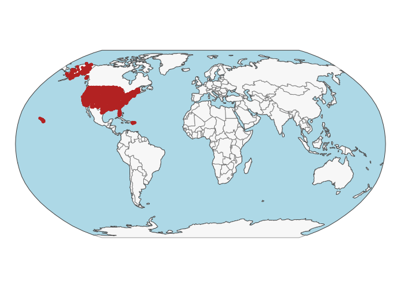
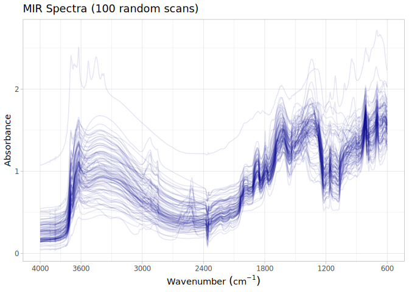
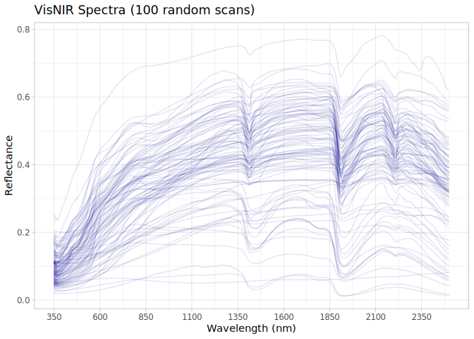

# KSSL (and RaCA) datasets
Jose L. Safanelli, Ran Zhi, Tomislav Hengl, Jonathan Sanderman

- [Original data](#original-data)
- [Data standardization to the OSSL
  format](#data-standardization-to-the-ossl-format)
  - [Site information](#site-information)
  - [Soil lab information (reference analytical
    data)](#soil-lab-information-reference-analytical-data)
  - [MIR spectra](#mir-spectra)
  - [Quality control for MIR](#quality-control-for-mir)
  - [VisNIR spectra](#visnir-spectra)
  - [Quality control for Vis-NIR](#quality-control-for-vis-nir)
- [References](#references)

Code repository for standardizing and importing the Kellogg Soil Survey
Laboratory (KSSL) and and Rapid Carbon Assesment (RaCA)into the Open
Soil Spectral Library.

Website: [Soil Spectroscopy for Global
Good](https://soilspectroscopy.org)  
Development: <https://github.com/soilspectroscopy>  
Last update: 2026-10-26  
Additional documentation:

## Original data

The USDA-NRCS NCSS Kellogg Soil Survey Laboratory (KSSL) has a largest
and growing mid-infrared (MIR) spectral library of the United States,
along with a historical VisNIR dataset produced as part of the Rapid
Carbon Assessment (RaCA).

An overview about the MIR analysis at the KSSL is available in
<https://www.nrcs.usda.gov/conservation-basics/soil/mid-infrared-spectroscopy>,
with the most of the data being distributed through the NCSS Lab Data
Mart:
<https://www.nrcs.usda.gov/resources/data-and-reports/ncss-soil-characterization-data-lab-data-mart>.
The RaCA is a legacy project with more information available at
<https://www.nrcs.usda.gov/resources/data-and-reports/rapid-carbon-assessment-raca>.

More information about the KSSL MIR library can be found in Seybold et
al. ([2019](#ref-Seybold2019)) and Nuwan K. Wijewardane, Ge, Wills, &
Libohova ([2018](#ref-wijewardane2018predicting)), while the Nuwan K.
Wijewardane, Ge, Wills, & Loecke ([2016](#ref-Wijewardane2016)) explored
the RaCA VNIR.

Input datasets (snapshot from Jul 2025):  
- `KSSL_202507_MIR_abs_raw_avg.csv` and
`RaCA_202507_VNIR_ref_raw_avg.csv`: csv file with averaged MIR or VNIR
scans processed from Bruker Opus or Malver Pananalytical ASD files;  
- `MIR_Spectra_Access_Portable_v2_3July2025.accdb` and
`VNIR_Spectra_Access_Portable_7-8-2025.accdb`: Microsoft Access database
with tables (site and soil) exported to csv files to `database`
`database_vnir`;

Directory/folder path with original files (not uploaded to GitHub).

``` r
# dir = "./"
dir = "~/mnt-ossl-private/database/datasets/KSSL/"
tic()
```

## Data standardization to the OSSL format

### Site information

``` r
########################
##### MIR database #####
########################
dir.db <- path(dir, "/database")

# Reading tables with site info
layer <- fread(path(dir.db, "/layer.csv"))
sample <- fread(path(dir.db, "/sample.csv"))
project <- fread(path(dir.db, "/project.csv"))
lims.site <- fread(path(dir.db, "/lims_site.csv"))
lims.pedtax <- fread(path(dir.db, "/lims_ped_tax_hist.csv"))
centroid <- fread(path(dir.db, "/centroid.csv"))
area <- fread(path(dir.db, "/area.csv"))
site.area <- fread(path(dir.db, "/site_area_overlap.csv"))

# Layer table contains only lay.id and horizon info
layer <- layer %>%
  select(lay.id, lay.type, proj.id, lims.site.id, lims.pedon.id,
         lay.depth.to.top, lay.depth.to.bottom, horizon.designation, texture.description)

# Sample table has lay and smp ids for linking all data in the database
sample <- sample %>%
  select(smp.id, lay.id)

# Project table with date of observation and project name
project <- project %>%
  select(proj.id, fiscal.year, submit.proj.name)

# Coordinates
lims.site <- lims.site %>%
  select(lims.site.id, horizontal.datum.name,
         latitude.std.decimal.degrees, longitude.std.decimal.degrees)

# Taxonomic classification
lims.pedtax <- lims.pedtax %>%
  select(lims.pedon.id, taxonomic.classification.name) %>%
  group_by(lims.pedon.id) %>%
  summarise_all(first)

# County centroids for additional spatial reference
centroid <- centroid %>%
  select(area.id, lat.ycntr, long.xcntr, fips.code)

# Area info
area <- area %>%
  select(area.id, area.type, area.name, area.code)

# Link between layers
site.area <- site.area %>%
  select(lims.site.id, area.id)

# Site area with county coordiantes
site.overview <- site.area %>%
  left_join(area, by = "area.id") %>%
  left_join(centroid, by = "area.id") %>%
  # filter(area.type %in% c("county"))
  filter(area.type %in% c("county", "country")) %>%
  pivot_wider(names_from = "area.type",
              values_from = c("area.id", "area.name", "area.code")) %>%
  group_by(lims.site.id) %>%
  reframe(across(everything(), ~first(na.omit(.x)))) %>%
  left_join(lims.site, by = "lims.site.id")

# Joining all data
kssl.sitedata <- layer %>%
  left_join(sample, by = "lay.id") %>%
  relocate(smp.id, .after = "lay.id") %>%
  left_join(project, by = "proj.id") %>%
  left_join(lims.pedtax, by = "lims.pedon.id") %>%
  left_join(site.overview, by = "lims.site.id") %>%
  as_tibble()

# Cleaning repeats and internal projects
kssl.sitedata <- kssl.sitedata %>%
  filter(!(proj.id == 1)) # This proj is used internally

# Just a few repeats, so we can first them
# repeat.ids <- kssl.sitedata %>%
#   group_by(lay.id) %>%
#   summarise(repeats = n()) %>%
#   filter(repeats > 1) %>%
#   pull(lay.id)
# 
# kssl.sitedata %>% filter(lay.id %in% repeat.ids)

kssl.sitedata <- kssl.sitedata %>%
  group_by(lay.id) %>%
  summarise(across(everything(), first))

# Available datums
kssl.sitedata %>%
  rename(hor.datum = horizontal.datum.name) %>%
  group_by(hor.datum) %>%
  summarise(count = n())
```

    # A tibble: 6 × 2
      hor.datum      count
      <chr>          <int>
    1 ""             18686
    2 "NAD27"         2086
    3 "NAD83"        22081
    4 "WGS84"        17590
    5 "old hawaiian"   192
    6  <NA>           1314

``` r
# We will assume layers with NA, empty and NULL in the datum column as NAD83
# The error between this US system is way smaller than assuming a county centroid
kssl.sitedata <- kssl.sitedata %>%
  mutate(horizontal.datum.name = ifelse(is.na(latitude.std.decimal.degrees),
                                        NA, 
                                        ifelse(horizontal.datum.name == '' |
                                                 horizontal.datum.name == 'NULL' |
                                                 is.na(horizontal.datum.name),
                                               "NAD83",
                                               horizontal.datum.name)))

# Corrected datums
kssl.sitedata %>%
  rename(hor.datum = horizontal.datum.name) %>%
  group_by(hor.datum) %>%
  summarise(count = n())
```

    # A tibble: 5 × 2
      hor.datum    count
      <chr>        <int>
    1 NAD27         2075
    2 NAD83        26871
    3 WGS84        16726
    4 old hawaiian   179
    5 <NA>         16098

``` r
# Transforming all datums to WGS84
datums <- kssl.sitedata %>%
  distinct(horizontal.datum.name) %>%
  pull(horizontal.datum.name)

projection.list <- list()

for(i in 1:length(datums)) {
  
  idatum <- datums[i]
  
  if(is.na(idatum)) {
    
    newdata <- kssl.sitedata %>%
      filter(is.na(horizontal.datum.name))
    
  } else if(idatum == "NAD27") {
    
    idata <- kssl.sitedata %>%
      filter(horizontal.datum.name == idatum)
    
    new.coords <- st_as_sf(idata,
                           crs = 4267,
                           coords = c("longitude.std.decimal.degrees",
                                      "latitude.std.decimal.degrees")) %>%
      st_transform(crs = 4326)
    
    newdata <- idata %>%
      mutate(longitude.std.decimal.degrees = st_coordinates(new.coords)[,1],
             latitude.std.decimal.degrees = st_coordinates(new.coords)[,2],
             horizontal.datum.name = "WGS84")
    
  }  else if(idatum == "NAD83") {
    
    idata <- kssl.sitedata %>%
      filter(horizontal.datum.name == idatum)
    
    new.coords <- st_as_sf(idata,
                           crs = 4269,
                           coords = c("longitude.std.decimal.degrees",
                                      "latitude.std.decimal.degrees")) %>%
      st_transform(crs = 4326) 
    
    newdata <- idata %>%
      mutate(longitude.std.decimal.degrees = st_coordinates(new.coords)[,1],
             latitude.std.decimal.degrees = st_coordinates(new.coords)[,2],
             horizontal.datum.name = "WGS84")
    
  } else if(idatum == "old hawaiian") {
    
    idata <- kssl.sitedata %>%
      filter(horizontal.datum.name == idatum)
    
    new.coords <- st_as_sf(idata,
                           crs = 4135,
                           coords = c("longitude.std.decimal.degrees",
                                      "latitude.std.decimal.degrees")) %>%
      st_transform(crs = 4326) 
    
    newdata <- idata %>%
      mutate(longitude.std.decimal.degrees = st_coordinates(new.coords)[,1],
             latitude.std.decimal.degrees = st_coordinates(new.coords)[,2],
             horizontal.datum.name = "WGS84")
    
  } else {
    
    newdata <- kssl.sitedata %>%
      filter(horizontal.datum.name == idatum)
    
  }
  
  projection.list[[i]] <- newdata
  
}

kssl.sitedata <- Reduce(bind_rows, projection.list)

# Correcting incorrect points

# Can't recover
id.pedons.na <- c(11930, 12776, 12778, 12779)

# Pedon ids that need a negative longitude
id.pedons.neg.longitude <- c(40135, 38043, 36777,
                             35124, 35125, 34509,
                             32888, 38958)

# Final corrected version
kssl.sitedata <- kssl.sitedata %>%
  mutate(longitude.std.decimal.degrees = ifelse(lims.pedon.id %in% id.pedons.na, NA, longitude.std.decimal.degrees),
         latitude.std.decimal.degrees = ifelse(lims.pedon.id %in% id.pedons.na, NA, latitude.std.decimal.degrees)) %>%
  mutate(longitude.std.decimal.degrees = ifelse(lims.pedon.id %in% id.pedons.neg.longitude, longitude.std.decimal.degrees*-1, longitude.std.decimal.degrees))

## Summary of pedons, layers and coordinates
kssl.sitedata %>%
  summarise(var = "total_layers", count = n()) %>%
  bind_rows(., tibble(var = "total_profiles", count = {kssl.sitedata %>%
      group_by(lims.pedon.id) %>%
      summarise(first_horizon = first(lay.id)) %>%
      ungroup() %>%
      summarise(count = n()) %>%
      pull(count)})) %>%
  bind_rows(., tibble(var = "profiles_with_point_coords", count = {kssl.sitedata %>%
      group_by(lims.pedon.id) %>%
      summarise(latitude.std.decimal.degrees = mean(latitude.std.decimal.degrees)) %>%
      filter(!is.na(latitude.std.decimal.degrees)) %>%
      ungroup() %>%
      summarise(count = n()) %>%
      pull(count)})) %>%
  bind_rows(., tibble(var = "profiles_with_county_coords", count = {kssl.sitedata %>%
      group_by(lims.pedon.id) %>%
      summarise(lat.ycntr = mean(lat.ycntr)) %>%
      filter(!is.na(lat.ycntr)) %>%
      ungroup() %>%
      summarise(count = n()) %>%
      pull(count)}))
```

    # A tibble: 4 × 2
      var                         count
      <chr>                       <int>
    1 total_layers                61949
    2 total_profiles              12946
    3 profiles_with_point_coords   8646
    4 profiles_with_county_coords 12601

``` r
# Formatting to OSSL names
kssl.sitedata <- kssl.sitedata %>%
  rename(id.layer_local_c = lay.id,
         id.project_ascii_txt = submit.proj.name,
         id.dataset.site_ascii_txt = lims.pedon.id,
         layer.upper.depth_usda_cm = lay.depth.to.top,
         layer.lower.depth_usda_cm = lay.depth.to.bottom,
         layer.texture_usda_txt = texture.description,
         pedon.taxa_usda_txt = taxonomic.classification.name,
         horizon.designation_usda_txt = horizon.designation,
         observation.date.end_iso.8601_yyyy.mm.dd = fiscal.year,
         longitude.point_wgs84_dd = longitude.std.decimal.degrees,
         latitude.point_wgs84_dd = latitude.std.decimal.degrees,
         longitude.county_wgs84_dd = long.xcntr,
         latitude.county_wgs84_dd = lat.ycntr) %>%
  mutate(id.layer_local_c = as.character(id.layer_local_c)) %>%
  select(id.layer_local_c, id.dataset.site_ascii_txt,
         layer.upper.depth_usda_cm, layer.lower.depth_usda_cm, layer.texture_usda_txt,
         pedon.taxa_usda_txt, horizon.designation_usda_txt, observation.date.end_iso.8601_yyyy.mm.dd,
         longitude.point_wgs84_dd, latitude.point_wgs84_dd,
         longitude.county_wgs84_dd, latitude.county_wgs84_dd) %>%
  mutate(observation.date.end_iso.8601_yyyy.mm.dd = ymd(paste0(observation.date.end_iso.8601_yyyy.mm.dd, "-12-31"))) %>%
  mutate(observation.date.begin_iso.8601_yyyy.mm.dd = floor_date(observation.date.end_iso.8601_yyyy.mm.dd, "year"),
         .before = observation.date.end_iso.8601_yyyy.mm.dd) %>%
  # mutate(location.point.error_any_m = 30,
  #        location.country_iso.3166_txt = "USA",
  #        observation.ogc.schema.title_ogc_txt = "Open Soil Spectroscopy Library",
  #        observation.ogc.schema_idn_url = "https://soilspectroscopy.github.io",
  #        surveyor.title_utf8_txt = "USDA NRCS staff",
  #        surveyor.contact_ietf_email = "rich.ferguson@usda.gov",
  #        surveyor.address_utf8_txt = "USDA-NRCS-NSSC, Federal Building, Room 152, Mail Stop, 100 Centennial Mall North, Lincoln, NE",
  #        dataset.title_utf8_txt = "Kellogg Soil Survey Laboratory database",
  #        dataset.owner_utf8_txt = "USDA, Soil and Plant Science Division, National Soil Survey Center",
  #        dataset.code_ascii_txt = "KSSL.SSL",
  #        dataset.address_idn_url = "http://ncsslabdatamart.sc.egov.usda.gov/",
  #        dataset.license.title_ascii_txt = "CC-BY",
  #        dataset.license.address_idn_url = "https://ncsslabdatamart.sc.egov.usda.gov/datause.aspx",
  #        dataset.doi_idf_url = "https://doi.org/10.2136/sssaj2019.06.0205",
  #        dataset.contact.name_utf8_txt = "Scarlett Murphy",
  #        dataset.contact_ietf_email = "Scarlett.Murphy@usda.gov") %>%
  mutate(dataset.code_ascii_txt = "KSSL",
         id.layer_uuid_txt = openssl::md5(paste0(dataset.code_ascii_txt, id.layer_local_c)),
         .before = 1) %>%
  mutate_at(vars(starts_with("id.")), as.character)

#########################
##### VNIR database #####
#########################
dir.db.vnir <- path(dir, "database_vnir")

# Reading tables with site info
layer2 <- fread(path(dir.db.vnir, "/layer.csv"))
sample2 <- fread(path(dir.db.vnir, "/sample.csv"))
project2 <- fread(path(dir.db.vnir, "/project.csv"))
lims.site2 <- fread(path(dir.db.vnir, "/lims_site.csv"))
lims.pedtax2 <- fread(path(dir.db.vnir, "/lims_ped_tax_hist.csv"))
centroid2 <- fread(path(dir.db.vnir, "/centroid.csv"))
area2 <- fread(path(dir.db.vnir, "/area.csv"))
site.area2 <- fread(path(dir.db.vnir, "/site_area_overlap.csv"))

# Layer table contains only lay.id and horizon info
layer2 <- layer2 %>%
  select(lay.id, lay.type, proj.id, lims.site.id, lims.pedon.id,
         lay.depth.to.top, lay.depth.to.bottom, horizon.designation, texture.description)

# Sample table has lay and smp ids for linking all data in the database
sample2 <- sample2 %>%
  select(smp.id, lay.id)

# Project table with date of observation and project name
project2 <- project2 %>%
  select(proj.id, fiscal.year, submit.proj.name)

# Coordinates
lims.site2 <- lims.site2 %>%
  select(lims.site.id, horizontal.datum.name,
         latitude.std.decimal.degrees, longitude.std.decimal.degrees)

# Taxonomic classification
lims.pedtax2 <- lims.pedtax2 %>%
  select(lims.pedon.id, taxonomic.classification.name) %>%
  group_by(lims.pedon.id) %>%
  summarise_all(first)

# County centroids for additional spatial reference
centroid2 <- centroid2 %>%
  select(area.id, lat.ycntr, long.xcntr, fips.code)

# Area info
area2 <- area2 %>%
  select(area.id, area.type, area.name, area.code)

# Link between layers
site.area2 <- site.area2 %>%
  select(lims.site.id, area.id)

# Site area with county coordiantes
site.overview2 <- site.area2 %>%
  left_join(area2, by = "area.id") %>%
  left_join(centroid2, by = "area.id") %>%
  filter(area.type %in% c("county", "country")) %>%
  pivot_wider(names_from = "area.type",
              values_from = c("area.id", "area.name", "area.code")) %>%
  group_by(lims.site.id) %>%
  reframe(across(everything(), ~first(na.omit(.x)))) %>%
  left_join(lims.site2, by = "lims.site.id")

# Joining all data
raca.sitedata <- layer2 %>%
  left_join(sample2, by = "lay.id") %>%
  relocate(smp.id, .after = "lay.id") %>%
  left_join(project2, by = "proj.id") %>%
  left_join(lims.pedtax2, by = "lims.pedon.id") %>%
  left_join(site.overview2, by = "lims.site.id") %>%
  as_tibble()

# Cleaning repeats and internal projects
raca.sitedata <- raca.sitedata %>%
  filter(!(proj.id == 1)) # This proj is used internally

raca.sitedata <- raca.sitedata %>%
  group_by(lay.id) %>%
  summarise_all(first)

# Available datums
raca.sitedata %>%
  rename(hor.datum = horizontal.datum.name) %>%
  group_by(hor.datum) %>%
  summarise(count = n())
```

    # A tibble: 5 × 2
      hor.datum count
      <chr>     <int>
    1 ""         7268
    2 "NAD27"     100
    3 "NAD83"   12156
    4 "WGS84"    4157
    5  <NA>       363

``` r
# We will assume layers with NA, empty and NULL in the datum column as NAD83
# The error between this US system is way smaller than assuming a county centroid
raca.sitedata <- raca.sitedata %>%
  mutate(horizontal.datum.name = ifelse(is.na(latitude.std.decimal.degrees),
                                        NA, 
                                        ifelse(horizontal.datum.name == '' |
                                                 horizontal.datum.name == 'NULL' |
                                                 is.na(horizontal.datum.name),
                                               "NAD83",
                                               horizontal.datum.name)))

# Corrected datums
raca.sitedata %>%
  rename(hor.datum = horizontal.datum.name) %>%
  group_by(hor.datum) %>%
  summarise(count = n())
```

    # A tibble: 4 × 2
      hor.datum count
      <chr>     <int>
    1 NAD27        92
    2 NAD83     13463
    3 WGS84      3525
    4 <NA>       6964

``` r
# Transforming all datums to WGS84
datums <- raca.sitedata %>%
  distinct(horizontal.datum.name) %>%
  pull(horizontal.datum.name)

projection.list <- list()

for(i in 1:length(datums)) {
  
  idatum <- datums[i]
  
  if(is.na(idatum)) {
    
    newdata <- raca.sitedata %>%
      filter(is.na(horizontal.datum.name))
    
  } else if(idatum == "NAD27") {
    
    idata <- raca.sitedata %>%
      filter(horizontal.datum.name == idatum)
    
    new.coords <- st_as_sf(idata,
                           crs = 4267,
                           coords = c("longitude.std.decimal.degrees",
                                      "latitude.std.decimal.degrees")) %>%
      st_transform(crs = 4326)
    
    newdata <- idata %>%
      mutate(longitude.std.decimal.degrees = st_coordinates(new.coords)[,1],
             latitude.std.decimal.degrees = st_coordinates(new.coords)[,2],
             horizontal.datum.name = "WGS84")
    
  }  else if(idatum == "NAD83") {
    
    idata <- raca.sitedata %>%
      filter(horizontal.datum.name == idatum)
    
    new.coords <- st_as_sf(idata,
                           crs = 4269,
                           coords = c("longitude.std.decimal.degrees",
                                      "latitude.std.decimal.degrees")) %>%
      st_transform(crs = 4326) 
    
    newdata <- idata %>%
      mutate(longitude.std.decimal.degrees = st_coordinates(new.coords)[,1],
             latitude.std.decimal.degrees = st_coordinates(new.coords)[,2],
             horizontal.datum.name = "WGS84")
    
  } else if(idatum == "old hawaiian") {
    
    idata <- raca.sitedata %>%
      filter(horizontal.datum.name == idatum)
    
    new.coords <- st_as_sf(idata,
                           crs = 4135,
                           coords = c("longitude.std.decimal.degrees",
                                      "latitude.std.decimal.degrees")) %>%
      st_transform(crs = 4326) 
    
    newdata <- idata %>%
      mutate(longitude.std.decimal.degrees = st_coordinates(new.coords)[,1],
             latitude.std.decimal.degrees = st_coordinates(new.coords)[,2],
             horizontal.datum.name = "WGS84")
    
  } else {
    
    newdata <- raca.sitedata %>%
      filter(horizontal.datum.name == idatum)
    
  }
  
  projection.list[[i]] <- newdata
  
}

raca.sitedata <- Reduce(bind_rows, projection.list)

# Unrecoverable ids
id.pedons.na <- c(10134, 11930, 12450, 12451, 12452, 12453)

# Pedon ids that need a negative longitude
id.pedons.neg.longitude <- c(32888)

# Final corrected version
raca.sitedata <- raca.sitedata %>%
  mutate(longitude.std.decimal.degrees = ifelse(lims.pedon.id %in% id.pedons.na, NA, longitude.std.decimal.degrees),
         latitude.std.decimal.degrees = ifelse(lims.pedon.id %in% id.pedons.na, NA, latitude.std.decimal.degrees)) %>%
  mutate(longitude.std.decimal.degrees = ifelse(lims.pedon.id %in% id.pedons.neg.longitude, longitude.std.decimal.degrees*-1, longitude.std.decimal.degrees))

## Summary of pedons, layers and coordinates
raca.sitedata %>%
  summarise(var = "total_layers", count = n()) %>%
  bind_rows(., tibble(var = "total_profiles", count = {raca.sitedata %>%
      group_by(lims.pedon.id) %>%
      summarise(first_horizon = first(lay.id)) %>%
      ungroup() %>%
      summarise(count = n()) %>%
      pull(count)})) %>%
  bind_rows(., tibble(var = "profiles_with_point_coords", count = {raca.sitedata %>%
      group_by(lims.pedon.id) %>%
      summarise(latitude.std.decimal.degrees = mean(latitude.std.decimal.degrees)) %>%
      filter(!is.na(latitude.std.decimal.degrees)) %>%
      ungroup() %>%
      summarise(count = n()) %>%
      pull(count)})) %>%
  bind_rows(., tibble(var = "profiles_with_county_coords", count = {raca.sitedata %>%
      group_by(lims.pedon.id) %>%
      summarise(lat.ycntr = mean(lat.ycntr)) %>%
      filter(!is.na(lat.ycntr)) %>%
      ungroup() %>%
      summarise(count = n()) %>%
      pull(count)}))
```

    # A tibble: 4 × 2
      var                         count
      <chr>                       <int>
    1 total_layers                24044
    2 total_profiles               5157
    3 profiles_with_point_coords   3140
    4 profiles_with_county_coords  5032

``` r
# Formatting to OSSL names
raca.sitedata <- raca.sitedata %>%
  rename(id.layer_local_c = lay.id,
         id.project_ascii_txt = submit.proj.name,
         id.dataset.site_ascii_txt = lims.pedon.id,
         layer.upper.depth_usda_cm = lay.depth.to.top,
         layer.lower.depth_usda_cm = lay.depth.to.bottom,
         layer.texture_usda_txt = texture.description,
         pedon.taxa_usda_txt = taxonomic.classification.name,
         horizon.designation_usda_txt = horizon.designation,
         observation.date.end_iso.8601_yyyy.mm.dd = fiscal.year,
         longitude.point_wgs84_dd = longitude.std.decimal.degrees,
         latitude.point_wgs84_dd = latitude.std.decimal.degrees,
         longitude.county_wgs84_dd = long.xcntr,
         latitude.county_wgs84_dd = lat.ycntr) %>%
  mutate(id.layer_local_c = as.character(id.layer_local_c)) %>%
  select(id.layer_local_c, id.dataset.site_ascii_txt,
         layer.upper.depth_usda_cm, layer.lower.depth_usda_cm, layer.texture_usda_txt,
         pedon.taxa_usda_txt, horizon.designation_usda_txt, observation.date.end_iso.8601_yyyy.mm.dd,
         longitude.point_wgs84_dd, latitude.point_wgs84_dd,
         longitude.county_wgs84_dd, latitude.county_wgs84_dd) %>%
  mutate(observation.date.end_iso.8601_yyyy.mm.dd = ymd(paste0(observation.date.end_iso.8601_yyyy.mm.dd, "-12-31"))) %>%
  mutate(observation.date.begin_iso.8601_yyyy.mm.dd = floor_date(observation.date.end_iso.8601_yyyy.mm.dd, "year"),
         .before = observation.date.end_iso.8601_yyyy.mm.dd) %>%
  mutate(dataset.code_ascii_txt = "KSSL",
         id.layer_uuid_txt = openssl::md5(paste0(dataset.code_ascii_txt, id.layer_local_c)),
         .before = 1) %>%
  mutate_at(vars(starts_with("id.")), as.character)

# Combining both site data.
# Some pedons/layers are available in both datasets, same info, so we first them
all.sitedata <- bind_rows(kssl.sitedata, raca.sitedata)

all.sitedata <- all.sitedata %>%
  summarise(across(everything(), first), .by = id.layer_local_c)

# Saving version to dataset root dir
site.exp.file = path(dir, "ossl_soilsite_v1.3")
readr::write_csv(all.sitedata, str_c(site.exp.file, ".csv.gz"))
nanoparquet::write_parquet(all.sitedata, str_c(site.exp.file, ".parquet"))
```

Plotting map:

``` r
data("World")

ocean <- ne_download(scale = 110, type = "ocean", category = "physical", returnclass = "sf")
```

    Reading 'ne_110m_ocean.zip' from naturalearth...

``` r
points <- kssl.sitedata %>%
  filter(!is.na(longitude.point_wgs84_dd),
         !is.na(latitude.point_wgs84_dd)) %>%
  st_as_sf(coords = c('longitude.point_wgs84_dd', 'latitude.point_wgs84_dd'), crs = 4326) %>%
  distinct(geometry)

tmap_mode("plot")
```

    ℹ tmap modes "plot" - "view"
    ℹ toggle with `tmap::ttm()`

``` r
tm_shape(ocean) +
  tm_polygons(fill = "lightblue", col = NA) +
  tm_shape(World) +
  tm_polygons(fill = "#f0f0f0", fill_alpha = 0.5, col_alpha = 0.5) +
  tm_shape(points) +
  tm_dots(fill = "firebrick") +
  tm_crs("ESRI:54030") +
  tm_layout(frame = FALSE)
```

    [tip] Consider a suitable map projection, e.g. by adding `+ tm_crs("auto")`.
    This message is displayed once per session.



### Soil lab information (reference analytical data)

NOTE: The code chunk below must be run just once for getting a template
for scripted column standardization. Just run once for getting the
original names of soil properties, descriptions, data types, and units.
Then upload to Google Sheet for editing and manually defining the rules
for integrating with the OSSL. Requires Google authentication. A copy of
the output file is saved to this folder for archiving purposes.

**Always leave the sheet name as TEMP to avoid overwritting, then rename
online to download locally.**

``` r
analyte <- read_csv(paste0(dir, "/database/analyte.csv"))
calc <- read_csv(paste0(dir, "/database/calc.csv"))

soillab.names <- analyte %>%
  select(analyte.id, analyte.name, analyte.abbrev, uom.abbrev, analyte.desc) %>%
  mutate(source = "kssl_analyte", .before = 1) %>%
  rename(id = analyte.id, original_name = analyte.name, abbrev = analyte.abbrev,
         unit = uom.abbrev, original_description = analyte.desc) %>%
  bind_rows({calc %>%
      select(calc.id, calc.name, calc.abbrev, uom.abbrev, calc.desc) %>%
      mutate(source = "kssl_calc", .before = 1) %>%
      rename(id = calc.id, original_name = calc.name, abbrev = calc.abbrev,
             unit = uom.abbrev, original_description = calc.desc)}) %>%
  arrange(original_name) %>%
  dplyr::mutate(import = '', ossl_name = '', .after = original_name)

readr::write_csv(soillab.names, paste0(getwd(), "/kssl_soillab_names.csv"))

# Uploading to google sheet

# FACT CIN folder. Get ID for soildata importing table
googledrive::drive_ls(as_id("0AHDIWmLAj40_Uk9PVA"))

OSSL.soildata.importing <- "19LeILz9AEnKVK7GK0ZbK3CCr2RfeP-gSWn5VpY8ETVM"

# Checking metadata
googlesheets4::as_sheets_id(OSSL.soildata.importing)

# Checking readme
googlesheets4::read_sheet(OSSL.soildata.importing, sheet = 'readme')

# Preparing soillab.names
upload <- dplyr::as_tibble(soillab.names)

# Uploading
googlesheets4::write_sheet(upload, ss = OSSL.soildata.importing, sheet = "TEMP")

# Checking metadata
googlesheets4::as_sheets_id(OSSL.soildata.importing)
```

NOTE: The code chunk below must be run just once. Run for getting the
column standardization rules after editing online on Google Sheets. A
copy of the edited standardization template is saved to this dataset
folder.

``` r
# Downloading from google sheet

# Checking metadata
googlesheets4::as_sheets_id("1mWTDJDuMp4oObcCxAy9gofSkrkcSWWf1TtEW2SuC1es")

# Preparing soillab.names
transvalues <- googlesheets4::read_sheet("1mWTDJDuMp4oObcCxAy9gofSkrkcSWWf1TtEW2SuC1es",
                                         sheet = "KSSL")

# Saving to folder
write_csv(transvalues, path(getwd(), "soillab_standardized_names.csv"))
```

Reading standardization rules:

``` r
transvalues <- read_csv(path(getwd(), "soillab_standardized_names.csv"),
                        show_col_types = F) %>%
  filter(import == TRUE) %>%
  select(contains(c("table", "id", "original_name", "ossl_")))

knitr::kable(transvalues)
```

| table | id | original_name | ossl_abbrev | ossl_method | ossl_unit | ossl_convert | ossl_name |
|:---|---:|:---|:---|:---|:---|:---|:---|
| kssl_analyte | 4 | db_13b | bd | usda.a4 | g.cm3 | ifelse(as.numeric(x) \< 0, NA, as.numeric(x)\*1) | bd_usda.a4_g.cm3 |
| kssl_analyte | 21 | db_fmstc | bd | usda.a21 | g.cm3 | ifelse(as.numeric(x) \< 0, NA, as.numeric(x)\*1) | bd_usda.a21_g.cm3 |
| kssl_calc | 236 | wf_g2_ws | cf | usda.c236 | w.pct | ifelse(as.numeric(x) \< 0, NA, as.numeric(x)\*1) | cf_usda.c236_w.pct |
| kssl_analyte | 9 | w3cld | wr.33kPa | usda.a9 | w.pct | ifelse(as.numeric(x) \< 0, NA, as.numeric(x)\*1) | wr.33kPa_usda.a9_w.pct |
| kssl_analyte | 415 | w32l2 | wr.33kPa | usda.a415 | w.pct | ifelse(as.numeric(x) \< 0, NA, as.numeric(x)\*1) | wr.33kPa_usda.a415_w.pct |
| kssl_analyte | 8 | w10cld | wr.10kPa | usda.a8 | w.pct | ifelse(as.numeric(x) \< 0, NA, as.numeric(x)\*1) | wr.10kPa_usda.a8_w.pct |
| kssl_analyte | 414 | w10l2 | wr.10kPa | usda.a414 | w.pct | ifelse(as.numeric(x) \< 0, NA, as.numeric(x)\*1) | wr.10kPa_usda.a414_w.pct |
| kssl_analyte | 417 | w15l2 | wr.1500kPa | usda.a417 | w.pct | ifelse(as.numeric(x) \< 0, NA, as.numeric(x)\*1) | wr.1500kPa_usda.a417_w.pct |
| kssl_calc | 80 | wrd_l2 | awc.33.1500kPa | usda.c80 | w.frac | ifelse(as.numeric(x) \< 0, NA, as.numeric(x)\*1) | awc.33.1500kPa_usda.c80_w.frac |
| kssl_calc | 60 | sand_tot_psa | sand.tot | usda.c60 | w.pct | ifelse(as.numeric(x) \< 0, NA, as.numeric(x)\*1) | sand.tot_usda.c60_w.pct |
| kssl_calc | 405 | sand_tot_psa | sand.tot | usda.c405 | w.pct | ifelse(as.numeric(x) \< 0, NA, as.numeric(x)\*1) | sand.tot_usda.c405_w.pct |
| kssl_calc | 62 | silt_tot_psa | silt.tot | usda.c62 | w.pct | ifelse(as.numeric(x) \< 0, NA, as.numeric(x)\*1) | silt.tot_usda.c62_w.pct |
| kssl_calc | 407 | silt_tot_psa | silt.tot | usda.c407 | w.pct | ifelse(as.numeric(x) \< 0, NA, as.numeric(x)\*1) | silt.tot_usda.c407_w.pct |
| kssl_analyte | 334 | clay_tot_psa | clay.tot | usda.a334 | w.pct | ifelse(as.numeric(x) \< 0, NA, as.numeric(x)\*1) | clay.tot_usda.a334_w.pct |
| kssl_analyte | 1 | aggstb | aggstb | usda.a1 | w.pct | ifelse(as.numeric(x) \< 0, NA, as.numeric(x)\*1) | aggstb_usda.a1_w.pct |
| kssl_analyte | 268 | ph_h2o | ph.h2o | usda.a268 | index | ifelse(as.numeric(x) \< 0, NA, as.numeric(x)\*1) | ph.h2o_usda.a268_index |
| kssl_analyte | 481 | ph_cacl2 | ph.cacl2 | usda.a481 | index | ifelse(as.numeric(x) \< 0, NA, as.numeric(x)\*1) | ph.cacl2_usda.a481_index |
| kssl_analyte | 477 | ph_hist | ph.cacl2 | usda.a477 | index | ifelse(as.numeric(x) \< 0, NA, as.numeric(x)\*1) | ph.cacl2_usda.a477_index |
| kssl_analyte | 364 | ec_12pre | ec | usda.a364 | ds.m | ifelse(as.numeric(x) \< 0, NA, as.numeric(x)\*1) | ec_usda.a364_ds.m |
| kssl_analyte | 479 | efferv_1nhcl | efferv | usda.a479 | class | x | efferv_usda.a479_class |
| kssl_analyte | 54 | caco3 | caco3 | usda.a54 | w.pct | ifelse(as.numeric(x) \< 0, NA, as.numeric(x)\*1) | caco3_usda.a54_w.pct |
| kssl_calc | 1059 | eoc_tot_c | oc | usda.c1059 | w.pct | ifelse(as.numeric(x) \< 0, NA, as.numeric(x)\*1) | oc_usda.c1059_w.pct |
| kssl_calc | 729 | eoc_tot_c | oc | usda.c729 | w.pct | ifelse(as.numeric(x) \< 0, NA, as.numeric(x)\*1) | oc_usda.c729_w.pct |
| kssl_analyte | 622 | c_tot_ncs | c.tot | usda.a622 | w.pct | ifelse(as.numeric(x) \< 0, NA, as.numeric(x)\*1) | c.tot_usda.a622_w.pct |
| kssl_analyte | 623 | n_tot_ncs | n.tot | usda.a623 | w.pct | ifelse(as.numeric(x) \< 0, NA, as.numeric(x)\*1) | n.tot_usda.a623_w.pct |
| kssl_analyte | 624 | s_tot_ncs | s.tot | usda.a624 | w.pct | ifelse(as.numeric(x) \< 0, NA, as.numeric(x)\*1) | s.tot_usda.a624_w.pct |
| kssl_analyte | 723 | cecd_nh4 | cec | usda.a723 | cmolc.kg | ifelse(as.numeric(x) \< 0, NA, as.numeric(x)\*1) | cec_usda.a723_cmolc.kg |
| kssl_analyte | 722 | ca_nh4d | ca.ext | usda.a722 | cmolc.kg | ifelse(as.numeric(x) \< 0, NA, as.numeric(x)\*1) | ca.ext_usda.a722_cmolc.kg |
| kssl_analyte | 1059 | ca_el_meh3 | ca.ext | usda.a1059 | mg.kg | ifelse(as.numeric(x) \< 0, NA, as.numeric(x)\*1) | ca.ext_usda.a1059_mg.kg |
| kssl_analyte | 724 | mg_nh4d | mg.ext | usda.a724 | cmolc.kg | ifelse(as.numeric(x) \< 0, NA, as.numeric(x)\*1) | mg.ext_usda.a724_cmolc.kg |
| kssl_analyte | 1066 | mg_el_meh3 | mg.ext | usda.a1066 | mg.kg | ifelse(as.numeric(x) \< 0, NA, as.numeric(x)\*1) | mg.ext_usda.a1066_mg.kg |
| kssl_analyte | 726 | na_nh4d | na.ext | usda.a726 | cmolc.kg | ifelse(as.numeric(x) \< 0, NA, as.numeric(x)\*1) | na.ext_usda.a726_cmolc.kg |
| kssl_analyte | 1068 | na_el_meh3 | na.ext | usda.a1068 | mg.kg | ifelse(as.numeric(x) \< 0, NA, as.numeric(x)\*1) | na.ext_usda.a1068_mg.kg |
| kssl_analyte | 725 | k_nh4d | k.ext | usda.a725 | cmolc.kg | ifelse(as.numeric(x) \< 0, NA, as.numeric(x)\*1) | k.ext_usda.a725_cmolc.kg |
| kssl_analyte | 1065 | k_el_meh3 | k.ext | usda.a1065 | mg.kg | ifelse(as.numeric(x) \< 0, NA, as.numeric(x)\*1) | k.ext_usda.a1065_mg.kg |
| kssl_analyte | 69 | al_kcl | al.ext | usda.a69 | cmolc.kg | ifelse(as.numeric(x) \< 0, NA, as.numeric(x)\*1) | al.ext_usda.a69_cmolc.kg |
| kssl_analyte | 1056 | al_el_meh3 | al.ext | usda.a1056 | mg.kg | ifelse(as.numeric(x) \< 0, NA, as.numeric(x)\*1) | al.ext_usda.a1056_mg.kg |
| kssl_analyte | 795 | acid_teac | acidity | usda.a795 | cmolc.kg | ifelse(as.numeric(x) \< 0, NA, as.numeric(x)\*1) | acidity_usda.a795_cmolc.kg |
| kssl_analyte | 274 | p_olsn | p.ext | usda.a274 | mg.kg | ifelse(as.numeric(x) \< 0, NA, as.numeric(x)\*1) | p.ext_usda.a274_mg.kg |
| kssl_analyte | 652 | p_mehlich3 | p.ext | usda.a652 | mg.kg | ifelse(as.numeric(x) \< 0, NA, as.numeric(x)\*1) | p.ext_usda.a652_mg.kg |
| kssl_analyte | 1070 | p_el_meh3 | p.ext | usda.a1070 | mg.kg | ifelse(as.numeric(x) \< 0, NA, as.numeric(x)\*1) | p.ext_usda.a1070_mg.kg |
| kssl_analyte | 270 | p_bray1 | p.ext | usda.a270 | mg.kg | ifelse(as.numeric(x) \< 0, NA, as.numeric(x)\*1) | p.ext_usda.a270_mg.kg |
| kssl_analyte | 70 | mn_kcl | mn.ext | usda.a70 | mg.kg | ifelse(as.numeric(x) \< 0, NA, as.numeric(x)\*1) | mn.ext_usda.a70_mg.kg |
| kssl_analyte | 1067 | mn_el_meh3 | mn.ext | usda.a1067 | mg.kg | ifelse(as.numeric(x) \< 0, NA, as.numeric(x)\*1) | mn.ext_usda.a1067_mg.kg |
| kssl_analyte | 1063 | cu_el_meh3 | cu.ext | usda.a1063 | mg.kg | ifelse(as.numeric(x) \< 0, NA, as.numeric(x)\*1) | cu.ext_usda.a1063_mg.kg |
| kssl_analyte | 1064 | fe_el_meh3 | fe.ext | usda.a1064 | mg.kg | ifelse(as.numeric(x) \< 0, NA, as.numeric(x)\*1) | fe.ext_usda.a1064_mg.kg |
| kssl_analyte | 1073 | zn_el_meh3 | zn.ext | usda.a1073 | mg.kg | ifelse(as.numeric(x) \< 0, NA, as.numeric(x)\*1) | zn.ext_usda.a1073_mg.kg |
| kssl_analyte | 66 | fe_dith | fe.dith | usda.a66 | w.pct | ifelse(as.numeric(x) \< 0, NA, as.numeric(x)\*1) | fe.dith_usda.a66_w.pct |
| kssl_analyte | 65 | al_dith | al.dith | usda.a65 | w.pct | ifelse(as.numeric(x) \< 0, NA, as.numeric(x)\*1) | al.dith_usda.a65_w.pct |
| kssl_analyte | 60 | fe_ox | fe.ox | usda.a60 | w.pct | ifelse(as.numeric(x) \< 0, NA, as.numeric(x)\*1) | fe.ox_usda.a60_w.pct |
| kssl_analyte | 59 | al_ox | al.ox | usda.a59 | w.pct | ifelse(as.numeric(x) \< 0, NA, as.numeric(x)\*1) | al.ox_usda.a59_w.pct |

Standardizing soil data to the OSSL format:

``` r
########################
##### MIR database #####
########################
dir.db <- path(dir, "/database")

# Reading tables with site info
layer <- fread(path(dir.db, "/layer.csv"))
sample <- fread(path(dir.db, "/sample.csv"))
layer.analyte <- fread(path(dir.db, "/layer_analyte.csv"))
result <- fread(path(dir.db, "/result.csv"))

# Analyte selection
analyte.sel.ids <- transvalues %>%
  filter(table == "kssl_analyte") %>%
  pull(id)

analyte.sel.names <- transvalues %>%
  filter(table == "kssl_analyte") %>%
  select(id, contains("ossl"))

layer.analyte.sel <- layer.analyte %>%
  filter(analyte.id %in% analyte.sel.ids) %>%
  select(analyte.id, lay.id, calc.value, master.prep.id) %>%
  left_join(analyte.sel.names, by = c("analyte.id" = "id")) %>%
  rename(value = calc.value, prep = master.prep.id) %>%
  select(contains("ossl"), lay.id, value, prep)

# Calc selection
calc.sel.ids <- transvalues %>%
  filter(table == "kssl_calc") %>%
  pull(id)

calc.sel.names <- transvalues %>%
  filter(table == "kssl_calc") %>%
  select(id, contains("ossl"))

layer.calc.sel <- result %>%
  filter(calc.id %in% calc.sel.ids) %>%
  select(calc.id, result.source.id, calc.value) %>%
  left_join(calc.sel.names, by = c("calc.id" = "id")) %>%
  rename(value = calc.value, lay.id = result.source.id) %>%
  select(contains("ossl"), lay.id, value)

kssl.soildata <- bind_rows(layer.analyte.sel, layer.calc.sel)

# Averaging minor repeats by unique numeric variable
# Only 2 NA is produced, dont worry
kssl.soildata.numeric <- kssl.soildata %>%
  filter(ossl_name != "efferv_usda.a479_class") %>%
  group_by(ossl_name, lay.id) %>%
  summarise(value = mean(as.numeric(value)), .groups = "drop") %>%
  filter(!is.na(value))
```

    Warning: There were 2 warnings in `summarise()`.
    The first warning was:
    ℹ In argument: `value = mean(as.numeric(value))`.
    ℹ In group 371942: `ossl_name = "cf_usda.c236_w.pct"`, `lay.id = 5336`.
    Caused by warning in `mean()`:
    ! NAs introduced by coercion
    ℹ Run `dplyr::last_dplyr_warnings()` to see the 1 remaining warning.

``` r
kssl.soildata.numeric.bind <- kssl.soildata.numeric %>%
  mutate(value = round(value, 5)) %>%
  pivot_wider(names_from = "ossl_name", values_from = value) %>%
  as.data.frame()

# The first column lay.id is preserved the same
functions.list <- transvalues %>%
  filter(ossl_name %in% names(kssl.soildata.numeric.bind)) %>%
  mutate(ossl_name = factor(ossl_name, levels = names(kssl.soildata.numeric.bind))) %>%
  arrange(ossl_name) %>%
  pull(ossl_convert) %>%
  c("x", .)

# Applying transformation rules
kssl.soildata.numeric.bind <- transform_values(df = kssl.soildata.numeric.bind,
                                               out.name = names(kssl.soildata.numeric.bind),
                                               in.name = names(kssl.soildata.numeric.bind),
                                               fun.lst = functions.list)

# Firsting minor repeats by unique character variable, i.e. only effervescence
# Checking effervescence levels
effervescence.levels <- kssl.soildata %>%
  filter(ossl_name == "efferv_usda.a479_class") %>%
  distinct(value) %>%
  pull(value)

# Simplifying to 5 levels: none, very slight, slight, strong, violent
new.effervescence.levels <- c("very slight", "none", "strong",
                              "violent", "slight", "none",
                              "none", "slight", "slight",
                              "strong", "violent", "very slight",
                              "very slight", "violent", "very slight",
                              "slight", "very slight", "violent",
                              "strong", "slight", "slight", "strong")

print(bind_cols(old = effervescence.levels, new = new.effervescence.levels), n=Inf)
```

    # A tibble: 22 × 2
       old                                 new        
       <chr>                               <chr>      
     1 very slight                         very slight
     2 none                                none       
     3 strong                              strong     
     4 violent                             violent    
     5 slight                              slight     
     6 none none                           none       
     7 none none none                      none       
     8 none slight                         slight     
     9 slight slight                       slight     
    10 strong strong                       strong     
    11 violent violent                     violent    
    12 very slight none                    very slight
    13 very slight very slight             very slight
    14 violent strong                      violent    
    15 none very slight                    very slight
    16 slight slight slight                slight     
    17 very slight very slight very slight very slight
    18 strong violent                      violent    
    19 strong strong strong                strong     
    20 slight very slight                  slight     
    21 very slight slight                  slight     
    22 strong slight                       strong     

``` r
# Recoding
names(new.effervescence.levels) <- effervescence.levels

kssl.soildata.class <- kssl.soildata %>%
  filter(ossl_name == "efferv_usda.a479_class") %>%
  group_by(ossl_name, lay.id) %>%
  summarise(value = first(value), .groups = "drop") %>%
  mutate(value = recode(value, !!!new.effervescence.levels))

kssl.soildata.class %>%
  distinct(value) %>%
  pull(value)
```

    [1] "none"        "strong"      "violent"     "slight"      "very slight"

``` r
kssl.soildata.class.bind <- kssl.soildata.class %>%
  pivot_wider(names_from = "ossl_name", values_from = value)

# Final soillab data
kssl.soildata <- left_join(kssl.soildata.numeric.bind, kssl.soildata.class.bind, by = "lay.id") %>%
  rename(id.layer_local_c = lay.id) %>%
  mutate_at(vars(starts_with("id.")), as.character)

kssl.soildata %>%
  count(id.layer_local_c) %>%
  count(n)
```

    Storing counts in `nn`, as `n` already present in input
    ℹ Use `name = "new_name"` to pick a new name.

      n    nn
    1 1 61676

``` r
#########################
##### VNIR database #####
#########################
dir.db.vnir <- path(dir, "database_vnir")

analyte2 <- fread(path(dir.db.vnir, "/analyte.csv"))
calc2 <- fread(path(dir.db.vnir, "/calc.csv"))
layer2 <- fread(path(dir.db.vnir, "/layer.csv"))
sample2 <- fread(path(dir.db.vnir, "/sample.csv"))
layer.analyte2 <- fread(path(dir.db.vnir, "/layer_analyte.csv"))
result2 <- fread(path(dir.db.vnir, "/result.csv"))

# Analyte selection
analyte.sel.ids <- transvalues %>%
  filter(table == "kssl_analyte") %>%
  pull(id)

analyte.sel.names <- transvalues %>%
  filter(table == "kssl_analyte") %>%
  select(id, contains("ossl"))

layer.analyte.sel2 <- layer.analyte2 %>%
  filter(analyte.id %in% analyte.sel.ids) %>%
  select(analyte.id, lay.id, calc.value, master.prep.id) %>%
  left_join(analyte.sel.names, by = c("analyte.id" = "id")) %>%
  rename(value = calc.value, prep = master.prep.id) %>%
  select(contains("ossl"), lay.id, value, prep)

# Calc selection
calc.sel.ids <- transvalues %>%
  filter(table == "kssl_calc") %>%
  pull(id)

calc.sel.names <- transvalues %>%
  filter(table == "kssl_calc") %>%
  select(id, contains("ossl"))

layer.calc.sel2 <- result2 %>%
  filter(calc.id %in% calc.sel.ids) %>%
  select(calc.id, result.source.id, calc.value) %>%
  left_join(calc.sel.names, by = c("calc.id" = "id")) %>%
  rename(value = calc.value, lay.id = result.source.id) %>%
  select(contains("ossl"), lay.id, value)

raca.soildata <- bind_rows(layer.analyte.sel2, layer.calc.sel2)

# Averaging minor repeats by unique numeric variable
# NA may be produced, dont worry
raca.soildata.numeric <- raca.soildata %>%
  filter(ossl_name != "efferv_usda.a479_class") %>%
  group_by(ossl_name, lay.id) %>%
  summarise(value = mean(as.numeric(value)), .groups = "drop") %>%
  filter(!is.na(value))

raca.soildata.numeric.bind <- raca.soildata.numeric %>%
  mutate(value = round(value, 5)) %>%
  pivot_wider(names_from = "ossl_name", values_from = value) %>%
  as.data.frame()

# The first column lay.id is preserved the same
functions.list <- transvalues %>%
  filter(ossl_name %in% names(raca.soildata.numeric.bind)) %>%
  mutate(ossl_name = factor(ossl_name, levels = names(raca.soildata.numeric.bind))) %>%
  arrange(ossl_name) %>%
  pull(ossl_convert) %>%
  c("x", .)

# Applying transformation rules
raca.soildata.numeric.bind <- transform_values(df = raca.soildata.numeric.bind,
                                               out.name = names(raca.soildata.numeric.bind),
                                               in.name = names(raca.soildata.numeric.bind),
                                               fun.lst = functions.list)

# Firsting minor repeats by unique character variable, i.e. only effervescence
# Checking effervescence levels
effervescence.levels <- raca.soildata %>%
  filter(ossl_name == "efferv_usda.a479_class") %>%
  distinct(value) %>%
  pull(value)

# Simplifying to 5 levels: none, very slight, slight, strong, violent
new.effervescence.levels <- c("none", "violent", "strong",
                              "slight", "very slight", "none",
                              "strong", "slight", "very slight",
                              "violent", "very slight", "very slight",
                              "violent", "slight", "strong",
                              "slight", "strong", "slight", "very slight")

print(bind_cols(old = effervescence.levels, new = new.effervescence.levels), n=Inf)
```

    # A tibble: 19 × 2
       old                                 new        
       <chr>                               <chr>      
     1 none                                none       
     2 violent                             violent    
     3 strong                              strong     
     4 slight                              slight     
     5 very slight                         very slight
     6 none none                           none       
     7 strong strong                       strong     
     8 slight slight                       slight     
     9 very slight very slight             very slight
    10 violent strong                      violent    
    11 none very slight                    very slight
    12 very slight none                    very slight
    13 strong violent                      violent    
    14 slight very slight                  slight     
    15 strong strong strong                strong     
    16 very slight slight                  slight     
    17 strong slight                       strong     
    18 slight slight slight                slight     
    19 very slight very slight very slight very slight

``` r
# Recoding
names(new.effervescence.levels) <- effervescence.levels

raca.soildata.class <- raca.soildata %>%
  filter(ossl_name == "efferv_usda.a479_class") %>%
  group_by(ossl_name, lay.id) %>%
  summarise(value = first(value), .groups = "drop") %>%
  mutate(value = recode(value, !!!new.effervescence.levels))

raca.soildata.class %>%
  distinct(value) %>%
  pull(value)
```

    [1] "strong"      "violent"     "none"        "very slight" "slight"     

``` r
raca.soildata.class.bind <- raca.soildata.class %>%
  pivot_wider(names_from = "ossl_name", values_from = value)

# Final soillab data
raca.soildata <- left_join(raca.soildata.numeric.bind, raca.soildata.class.bind, by = "lay.id") %>%
  rename(id.layer_local_c = lay.id) %>%
  mutate_at(vars(starts_with("id.")), as.character)

raca.soildata %>%
  count(id.layer_local_c) %>%
  count(n)
```

    Storing counts in `nn`, as `n` already present in input
    ℹ Use `name = "new_name"` to pick a new name.

      n    nn
    1 1 24044

``` r
# Combining both site data.
# Some pedons/layers are available in both datasets, same info, so we first them
all.soildata <- bind_rows(kssl.soildata, raca.soildata)

all.soildata <- as.data.table(all.soildata)[,lapply(.SD, \(x){first(x[!is.na(x)])}),keyby=id.layer_local_c]

all.soildata <- as_tibble(all.soildata)

# Saving version to dataset root dir
soillab.exp.file = path(dir, "ossl_soillab_v1.3")
readr::write_csv(all.soildata, str_c(soillab.exp.file, ".csv.gz"))
nanoparquet::write_parquet(all.soildata, str_c(soillab.exp.file, ".parquet"))
```

Soil lab data summary.

``` r
all.soildata %>%
  mutate(id.layer_local_c = factor(id.layer_local_c)) %>%
  skimr::skim() %>%
  dplyr::select(-numeric.hist, -complete_rate)
```

|                                                  |            |
|:-------------------------------------------------|:-----------|
| Name                                             | Piped data |
| Number of rows                                   | 64667      |
| Number of columns                                | 52         |
| \_\_\_\_\_\_\_\_\_\_\_\_\_\_\_\_\_\_\_\_\_\_\_   |            |
| Column type frequency:                           |            |
| character                                        | 1          |
| factor                                           | 1          |
| numeric                                          | 50         |
| \_\_\_\_\_\_\_\_\_\_\_\_\_\_\_\_\_\_\_\_\_\_\_\_ |            |
| Group variables                                  | None       |

Data summary

**Variable type: character**

| skim_variable          | n_missing | min | max | empty | n_unique | whitespace |
|:-----------------------|----------:|----:|----:|------:|---------:|-----------:|
| efferv_usda.a479_class |      1287 |   4 |  11 |     0 |        5 |          0 |

**Variable type: factor**

| skim_variable    | n_missing | ordered | n_unique | top_counts                     |
|:-----------------|----------:|:--------|---------:|:-------------------------------|
| id.layer_local_c |         0 | FALSE   |    64667 | 100: 1, 100: 1, 100: 1, 100: 1 |

**Variable type: numeric**

| skim_variable | n_missing | mean | sd | p0 | p25 | p50 | p75 | p100 |
|:---|---:|---:|---:|---:|---:|---:|---:|---:|
| acidity_usda.a795_cmolc.kg | 29776 | 14.47 | 24.31 | 0.00 | 3.70 | 7.14 | 13.48 | 291.92 |
| aggstb_usda.a1_w.pct | 60668 | 39.45 | 30.11 | 0.00 | 12.00 | 33.00 | 65.00 | 123.00 |
| al.dith_usda.a65_w.pct | 26780 | 0.20 | 0.35 | 0.00 | 0.05 | 0.11 | 0.21 | 7.70 |
| al.ext_usda.a1056_mg.kg | 63153 | 878.63 | 774.47 | 0.07 | 318.70 | 751.04 | 1158.34 | 6748.01 |
| al.ext_usda.a69_cmolc.kg | 47387 | 2.27 | 3.39 | 0.00 | 0.31 | 1.03 | 2.88 | 63.01 |
| al.ox_usda.a59_w.pct | 32485 | 0.27 | 0.56 | 0.00 | 0.06 | 0.12 | 0.23 | 12.63 |
| awc.33.1500kPa_usda.c80_w.frac | 43223 | 0.15 | 0.07 | 0.00 | 0.11 | 0.14 | 0.19 | 0.81 |
| bd_usda.a21_g.cm3 | 57051 | 0.94 | 0.50 | 0.01 | 0.53 | 1.04 | 1.32 | 8.10 |
| bd_usda.a4_g.cm3 | 42189 | 1.38 | 0.26 | 0.02 | 1.26 | 1.40 | 1.54 | 2.53 |
| c.tot_usda.a622_w.pct | 223 | 4.33 | 9.51 | 0.00 | 0.41 | 1.27 | 3.13 | 63.45 |
| ca.ext_usda.a1059_mg.kg | 63153 | 5634.75 | 9321.06 | 3.09 | 656.32 | 2258.41 | 4789.45 | 44723.96 |
| ca.ext_usda.a722_cmolc.kg | 4650 | 22.04 | 32.60 | 0.00 | 2.94 | 11.46 | 29.25 | 388.18 |
| caco3_usda.a54_w.pct | 41377 | 9.42 | 14.87 | 0.00 | 0.26 | 2.56 | 13.24 | 105.77 |
| cec_usda.a723_cmolc.kg | 4656 | 20.63 | 22.91 | 0.00 | 7.49 | 14.97 | 24.63 | 584.59 |
| cf_usda.c236_w.pct | 1655 | 8.79 | 17.05 | 0.00 | 0.00 | 0.41 | 8.00 | 100.00 |
| clay.tot_usda.a334_w.pct | 8058 | 22.87 | 16.30 | 0.00 | 9.61 | 20.84 | 32.50 | 96.14 |
| cu.ext_usda.a1063_mg.kg | 63153 | 2.59 | 4.25 | 0.00 | 0.44 | 1.66 | 3.06 | 77.82 |
| ec_usda.a364_ds.m | 28827 | 2.85 | 12.00 | 0.00 | 0.11 | 0.26 | 0.87 | 313.13 |
| fe.dith_usda.a66_w.pct | 26778 | 1.24 | 1.64 | 0.00 | 0.32 | 0.80 | 1.55 | 28.44 |
| fe.ext_usda.a1064_mg.kg | 63153 | 113.04 | 124.91 | 0.00 | 51.58 | 89.31 | 140.02 | 2708.08 |
| fe.ox_usda.a60_w.pct | 32486 | 0.43 | 0.71 | 0.00 | 0.09 | 0.23 | 0.53 | 22.27 |
| k.ext_usda.a1065_mg.kg | 63153 | 177.58 | 170.73 | 0.00 | 77.71 | 139.78 | 234.39 | 1699.61 |
| k.ext_usda.a725_cmolc.kg | 4652 | 0.64 | 1.04 | 0.00 | 0.14 | 0.34 | 0.72 | 32.33 |
| mg.ext_usda.a1066_mg.kg | 63153 | 510.49 | 528.72 | 0.00 | 91.39 | 369.35 | 788.47 | 5608.60 |
| mg.ext_usda.a724_cmolc.kg | 4650 | 5.36 | 8.26 | 0.00 | 0.87 | 2.82 | 6.55 | 172.64 |
| mn.ext_usda.a1067_mg.kg | 63153 | 73.41 | 81.38 | 0.00 | 16.19 | 45.74 | 102.72 | 544.19 |
| mn.ext_usda.a70_mg.kg | 47390 | 13.25 | 103.15 | 0.00 | 0.12 | 0.80 | 4.10 | 9787.33 |
| n.tot_usda.a623_w.pct | 223 | 0.24 | 0.55 | 0.00 | 0.04 | 0.09 | 0.20 | 41.90 |
| na.ext_usda.a1068_mg.kg | 63153 | 183.75 | 701.06 | 0.00 | 12.05 | 30.59 | 104.68 | 15207.10 |
| na.ext_usda.a726_cmolc.kg | 4652 | 3.95 | 23.24 | 0.00 | 0.00 | 0.02 | 0.24 | 868.36 |
| oc_usda.c1059_w.pct | 63499 | 4.46 | 9.77 | 0.01 | 0.50 | 1.28 | 2.81 | 56.40 |
| oc_usda.c729_w.pct | 2231 | 3.95 | 9.59 | 0.00 | 0.28 | 0.82 | 2.36 | 63.45 |
| p.ext_usda.a1070_mg.kg | 63153 | 22.20 | 36.86 | 0.00 | 3.47 | 10.64 | 24.97 | 506.24 |
| p.ext_usda.a270_mg.kg | 56546 | 18.52 | 48.21 | 0.00 | 1.00 | 4.49 | 16.07 | 1436.68 |
| p.ext_usda.a274_mg.kg | 49180 | 12.43 | 20.91 | 0.00 | 1.74 | 5.15 | 14.59 | 623.13 |
| p.ext_usda.a652_mg.kg | 39184 | 26.05 | 159.17 | 0.00 | 2.45 | 9.18 | 29.22 | 24425.23 |
| ph.cacl2_usda.a477_index | 62992 | 4.73 | 1.25 | 1.74 | 3.74 | 4.61 | 5.60 | 8.27 |
| ph.cacl2_usda.a481_index | 5087 | 5.93 | 1.41 | 2.14 | 4.74 | 5.76 | 7.33 | 10.68 |
| ph.h2o_usda.a268_index | 5086 | 6.44 | 1.35 | 1.97 | 5.35 | 6.32 | 7.70 | 10.70 |
| s.tot_usda.a624_w.pct | 224 | 0.16 | 0.90 | 0.00 | 0.00 | 0.01 | 0.04 | 25.24 |
| sand.tot_usda.c405_w.pct | 63774 | 33.76 | 27.17 | 0.30 | 8.90 | 24.70 | 59.70 | 98.40 |
| sand.tot_usda.c60_w.pct | 8988 | 39.33 | 28.88 | 0.10 | 13.30 | 34.70 | 61.70 | 100.00 |
| silt.tot_usda.c407_w.pct | 63774 | 35.09 | 15.41 | 0.90 | 24.40 | 31.30 | 46.20 | 78.10 |
| silt.tot_usda.c62_w.pct | 8988 | 37.93 | 20.20 | 0.00 | 22.70 | 38.00 | 53.00 | 94.50 |
| wr.10kPa_usda.a414_w.pct | 61617 | 30.38 | 20.43 | 0.68 | 17.75 | 30.53 | 38.83 | 355.29 |
| wr.10kPa_usda.a8_w.pct | 62384 | 30.93 | 33.40 | 2.65 | 19.60 | 25.58 | 31.90 | 553.17 |
| wr.1500kPa_usda.a417_w.pct | 15316 | 14.27 | 16.29 | 0.02 | 6.54 | 11.11 | 16.37 | 303.03 |
| wr.33kPa_usda.a415_w.pct | 61046 | 26.09 | 23.85 | 0.26 | 13.04 | 23.13 | 31.96 | 221.34 |
| wr.33kPa_usda.a9_w.pct | 42185 | 26.20 | 27.11 | 1.34 | 17.67 | 23.20 | 28.90 | 2124.87 |
| zn.ext_usda.a1073_mg.kg | 63153 | 2.48 | 12.06 | 0.00 | 0.36 | 0.99 | 2.02 | 314.72 |

### MIR spectra

MIR is stored in reflectance units, so we transform to absorbance.

``` r
# MIR averaged
mir.scans <- fread(path(dir, "/KSSL_202507_MIR_abs_raw_avg.csv"), header = TRUE)

# Getting only XS and XN prep scans
imported.mir.ids <- mir.scans %>%
  rename(scan.id = sample_id) %>% # recoded to scan id = sample+prep
  select(scan.id) %>%
  as_tibble() %>%
  mutate(prep = str_sub(scan.id, -2, -1),
         smp.id = as.numeric(str_sub(scan.id, 1, -3)))

mir.selected.smp.ids <- imported.mir.ids %>%
  filter(prep %in% c("XS", "XN")) %>% 
  distinct(smp.id) %>%
  pull()

mir.selected.scan.ids <- imported.mir.ids %>%
  filter(prep %in% c("XS", "XN")) %>% 
  distinct(scan.id) %>%
  pull()

mir.scans <- mir.scans %>%
  filter(sample_id %in% mir.selected.scan.ids)

# Recoding smp.id to lay.id for filtering joining with other tables
mir.selected.lay.ids <- sample %>%
  filter(smp.id %in% mir.selected.smp.ids) %>%
  select(smp.id, lay.id)

# Final preparation
kssl.mir <- imported.mir.ids %>%
  filter(smp.id %in% mir.selected.smp.ids) %>%
  left_join(mir.selected.lay.ids, by = "smp.id") %>%
  right_join(mir.scans, by = c("scan.id" = "sample_id"))

# Spectral consistency analysis

# Repeats check - Duplicates are dropped
kssl.mir.check <- kssl.mir %>%
  select(lay.id, `600`) %>%
  filter(!is.na(lay.id))

dupli.ids <- kssl.mir.check %>%
  count(lay.id) %>%
  filter(n > 1) %>%
  pull(lay.id)

kssl.mir <- kssl.mir %>%
  filter(!(lay.id %in% dupli.ids)) %>%
  filter(!is.na(lay.id))

# Gaps
scans.na.gaps <- kssl.mir %>%
  select(-all_of(c("scan.id","prep","smp.id","lay.id"))) %>%
  apply(., 1, function(x) round(100*(sum(is.na(x)))/(length(x)), 2)) %>%
  tibble(proportion_NA = .) %>%
  bind_cols({kssl.mir %>% select(lay.id)}, .)

# Extreme negative - irreversible erratic patterns
scans.extreme.neg <- kssl.mir %>%
  select(-all_of(c("scan.id","prep","smp.id","lay.id"))) %>%
  apply(., 1, function(x) {round(100*(sum(x < -1, na.rm=TRUE))/(length(x)), 2)}) %>%
  tibble(proportion_lower0 = .) %>%
  bind_cols({kssl.mir %>% select(lay.id)}, .)

# Extreme positive, irreversible erratic patterns
scans.extreme.pos <- kssl.mir %>%
  select(-all_of(c("scan.id","prep","smp.id","lay.id"))) %>%
  apply(., 1, function(x) {round(100*(sum(x > 5, na.rm=TRUE))/(length(x)), 2)}) %>%
  tibble(proportion_higherAbs5 = .) %>%
  bind_cols({kssl.mir %>% select(lay.id)}, .)

# Consistency summary - problematic scans
scans.summary <- scans.na.gaps %>%
  left_join(scans.extreme.neg, by = "lay.id") %>%
  left_join(scans.extreme.pos, by = "lay.id")

scans.summary %>%
  select(-lay.id) %>%
  pivot_longer(everything(), names_to = "check", values_to = "value") %>%
  filter(value > 0) %>%
  group_by(check) %>%
  summarise(count = n())
```

    # A tibble: 0 × 2
    # ℹ 2 variables: check <chr>, count <int>

``` r
# Formatting to OSSL specs
old.wavenumbers <- seq(600, 4000, by = 2)
new.wavenumbers <- paste0("scan_mir.", old.wavenumbers, "_abs")

kssl.mir <- kssl.mir %>%
  rename_with(~new.wavenumbers, all_of(as.character(old.wavenumbers)))

kssl.mir <- kssl.mir %>%
  select(-prep) %>%
  rename(id.scan_local_c = scan.id,
         id.sample_local_c = smp.id,
         id.layer_local_c = lay.id) %>%
  mutate(across(starts_with("id"), as.character))

# Saving version to dataset root dir
mir.exp.file = path(dir, "ossl_mir_v1.3")
readr::write_csv(kssl.mir, str_c(mir.exp.file, ".csv.gz"))
nanoparquet::write_parquet(kssl.mir, str_c(mir.exp.file, ".parquet"))
```

### Quality control for MIR

The final table must be joined as follows:

- MIR is used as first reference for pairing with soil data.
- Soil lab data are left joined to MIR. This drop data without any
  available scan.

The availability of data is summarized below:

``` r
# Taking a few representative columns for checking the consistency of joins
kssl.mir.availability <- kssl.mir %>%
  select(id.layer_local_c, scan_mir.1000_abs) %>%
  left_join(kssl.soildata, by = "id.layer_local_c")

# Repeats double-check - Duplicates were previously dropped
kssl.mir.availability %>%
  mutate_all(as.character) %>%
  select(id.layer_local_c) %>%
  pivot_longer(everything(), names_to = "column", values_to = "value") %>%
  group_by(column, value) %>%
  summarise(repeats = n()) %>%
  group_by(column, repeats) %>%
  summarise(count = n())
```

    `summarise()` has regrouped the output.
    `summarise()` has regrouped the output.
    ℹ Summaries were computed grouped by column and value.
    ℹ Output is grouped by column.
    ℹ Use `summarise(.groups = "drop_last")` to silence this message.
    ℹ Use `summarise(.by = c(column, value))` for per-operation grouping
      (`?dplyr::dplyr_by`) instead.

    # A tibble: 1 × 3
    # Groups:   column [1]
      column           repeats count
      <chr>              <int> <int>
    1 id.layer_local_c       1 61502

``` r
# Availability of data-spectra pairs
kssl.mir.availability %>%
  mutate_all(as.character) %>%
  pivot_longer(everything(), names_to = "column", values_to = "value") %>%
  filter(!is.na(value)) %>%
  group_by(column) %>%
  summarise(count = n())
```

    # A tibble: 53 × 2
       column                         count
       <chr>                          <int>
     1 acidity_usda.a795_cmolc.kg     32907
     2 aggstb_usda.a1_w.pct            3909
     3 al.dith_usda.a65_w.pct         35821
     4 al.ext_usda.a1056_mg.kg         1336
     5 al.ext_usda.a69_cmolc.kg       16381
     6 al.ox_usda.a59_w.pct           30669
     7 awc.33.1500kPa_usda.c80_w.frac 20071
     8 bd_usda.a21_g.cm3               7503
     9 bd_usda.a4_g.cm3               21095
    10 c.tot_usda.a622_w.pct          61255
    # ℹ 43 more rows

Soil analytical data summary for MIR. Note: many scans could not be
linked with the wetchem.

``` r
kssl.mir.availability %>%
  mutate(id.layer_local_c = factor(id.layer_local_c)) %>%
  skimr::skim() %>%
  dplyr::select(-numeric.hist, -complete_rate)
```

|                                                  |            |
|:-------------------------------------------------|:-----------|
| Name                                             | Piped data |
| Number of rows                                   | 61502      |
| Number of columns                                | 53         |
| \_\_\_\_\_\_\_\_\_\_\_\_\_\_\_\_\_\_\_\_\_\_\_   |            |
| Column type frequency:                           |            |
| character                                        | 1          |
| factor                                           | 1          |
| numeric                                          | 51         |
| \_\_\_\_\_\_\_\_\_\_\_\_\_\_\_\_\_\_\_\_\_\_\_\_ |            |
| Group variables                                  | None       |

Data summary

**Variable type: character**

| skim_variable          | n_missing | min | max | empty | n_unique | whitespace |
|:-----------------------|----------:|----:|----:|------:|---------:|-----------:|
| efferv_usda.a479_class |      1300 |   4 |  11 |     0 |        5 |          0 |

**Variable type: factor**

| skim_variable    | n_missing | ordered | n_unique | top_counts                     |
|:-----------------|----------:|:--------|---------:|:-------------------------------|
| id.layer_local_c |         0 | FALSE   |    61502 | 100: 1, 100: 1, 100: 1, 100: 1 |

**Variable type: numeric**

| skim_variable | n_missing | mean | sd | p0 | p25 | p50 | p75 | p100 |
|:---|---:|---:|---:|---:|---:|---:|---:|---:|
| scan_mir.1000_abs | 0 | 1.23 | 0.16 | 0.29 | 1.13 | 1.23 | 1.33 | 2.22 |
| acidity_usda.a795_cmolc.kg | 28595 | 14.85 | 24.82 | 0.00 | 3.78 | 7.24 | 13.88 | 291.92 |
| aggstb_usda.a1_w.pct | 57593 | 39.53 | 30.09 | 0.00 | 12.00 | 33.00 | 65.00 | 123.00 |
| al.dith_usda.a65_w.pct | 25681 | 0.20 | 0.35 | 0.00 | 0.05 | 0.11 | 0.22 | 7.70 |
| al.ext_usda.a1056_mg.kg | 60166 | 899.98 | 815.19 | 0.07 | 258.92 | 752.69 | 1286.52 | 6748.01 |
| al.ext_usda.a69_cmolc.kg | 45121 | 2.31 | 3.44 | 0.00 | 0.32 | 1.06 | 2.94 | 63.01 |
| al.ox_usda.a59_w.pct | 30833 | 0.27 | 0.57 | 0.00 | 0.06 | 0.12 | 0.24 | 12.63 |
| awc.33.1500kPa_usda.c80_w.frac | 41431 | 0.15 | 0.07 | 0.00 | 0.11 | 0.14 | 0.19 | 0.81 |
| bd_usda.a21_g.cm3 | 53999 | 0.94 | 0.50 | 0.01 | 0.53 | 1.04 | 1.32 | 8.10 |
| bd_usda.a4_g.cm3 | 40407 | 1.37 | 0.26 | 0.02 | 1.26 | 1.40 | 1.54 | 2.53 |
| c.tot_usda.a622_w.pct | 247 | 4.44 | 9.68 | 0.00 | 0.42 | 1.29 | 3.20 | 63.45 |
| ca.ext_usda.a1059_mg.kg | 60166 | 5887.32 | 9783.43 | 3.09 | 648.15 | 2034.96 | 4936.04 | 44723.96 |
| ca.ext_usda.a722_cmolc.kg | 4491 | 22.09 | 33.00 | 0.00 | 2.99 | 11.35 | 28.75 | 388.18 |
| caco3_usda.a54_w.pct | 39695 | 9.34 | 14.71 | 0.00 | 0.26 | 2.46 | 13.24 | 105.77 |
| cec_usda.a723_cmolc.kg | 4497 | 20.97 | 23.28 | 0.00 | 7.66 | 15.14 | 24.92 | 584.59 |
| cf_usda.c236_w.pct | 1570 | 8.87 | 17.14 | 0.00 | 0.00 | 0.40 | 8.00 | 100.00 |
| clay.tot_usda.a334_w.pct | 7975 | 23.03 | 16.31 | 0.00 | 9.84 | 21.02 | 32.64 | 96.14 |
| cu.ext_usda.a1063_mg.kg | 60166 | 2.46 | 3.66 | 0.00 | 0.42 | 1.55 | 3.07 | 77.82 |
| ec_usda.a364_ds.m | 27371 | 2.94 | 12.24 | 0.00 | 0.11 | 0.26 | 0.89 | 313.13 |
| fe.dith_usda.a66_w.pct | 25679 | 1.25 | 1.65 | 0.00 | 0.33 | 0.82 | 1.57 | 28.44 |
| fe.ext_usda.a1064_mg.kg | 60166 | 112.98 | 130.82 | 0.00 | 48.52 | 87.17 | 139.65 | 2708.08 |
| fe.ox_usda.a60_w.pct | 30834 | 0.43 | 0.72 | 0.00 | 0.09 | 0.24 | 0.54 | 22.27 |
| k.ext_usda.a1065_mg.kg | 60166 | 182.59 | 176.91 | 0.00 | 81.34 | 141.66 | 237.22 | 1699.61 |
| k.ext_usda.a725_cmolc.kg | 4493 | 0.65 | 1.05 | 0.00 | 0.15 | 0.35 | 0.72 | 32.33 |
| mg.ext_usda.a1066_mg.kg | 60166 | 507.55 | 545.03 | 0.00 | 91.86 | 332.46 | 777.22 | 5608.60 |
| mg.ext_usda.a724_cmolc.kg | 4491 | 5.40 | 8.36 | 0.00 | 0.88 | 2.83 | 6.56 | 172.64 |
| mn.ext_usda.a1067_mg.kg | 60166 | 73.77 | 80.82 | 0.00 | 16.81 | 46.60 | 103.44 | 544.19 |
| mn.ext_usda.a70_mg.kg | 45124 | 13.91 | 105.90 | 0.00 | 0.14 | 0.89 | 4.41 | 9787.33 |
| n.tot_usda.a623_w.pct | 247 | 0.25 | 0.56 | 0.00 | 0.04 | 0.09 | 0.21 | 41.90 |
| na.ext_usda.a1068_mg.kg | 60166 | 193.14 | 743.72 | 0.00 | 11.86 | 28.91 | 103.26 | 15207.10 |
| na.ext_usda.a726_cmolc.kg | 4493 | 4.08 | 23.74 | 0.00 | 0.00 | 0.02 | 0.25 | 868.36 |
| oc_usda.c1059_w.pct | 60347 | 4.50 | 9.81 | 0.01 | 0.52 | 1.33 | 2.86 | 56.40 |
| oc_usda.c729_w.pct | 2108 | 4.07 | 9.77 | 0.00 | 0.29 | 0.85 | 2.43 | 63.45 |
| p.ext_usda.a1070_mg.kg | 60166 | 23.05 | 38.40 | 0.00 | 3.21 | 10.95 | 26.73 | 506.24 |
| p.ext_usda.a270_mg.kg | 53668 | 18.86 | 48.93 | 0.00 | 1.03 | 4.55 | 16.70 | 1436.68 |
| p.ext_usda.a274_mg.kg | 46478 | 12.49 | 20.95 | 0.00 | 1.75 | 5.19 | 14.71 | 623.13 |
| p.ext_usda.a652_mg.kg | 36895 | 26.09 | 161.83 | 0.00 | 2.46 | 9.13 | 29.01 | 24425.23 |
| ph.cacl2_usda.a477_index | 59840 | 4.72 | 1.25 | 1.74 | 3.73 | 4.60 | 5.60 | 8.27 |
| ph.cacl2_usda.a481_index | 5011 | 5.92 | 1.40 | 2.14 | 4.73 | 5.74 | 7.29 | 10.68 |
| ph.h2o_usda.a268_index | 5010 | 6.42 | 1.34 | 1.97 | 5.34 | 6.30 | 7.67 | 10.70 |
| s.tot_usda.a624_w.pct | 248 | 0.16 | 0.92 | 0.00 | 0.00 | 0.01 | 0.04 | 25.24 |
| sand.tot_usda.c405_w.pct | 60622 | 33.06 | 26.66 | 0.30 | 8.80 | 23.70 | 59.02 | 98.40 |
| sand.tot_usda.c60_w.pct | 8846 | 39.00 | 28.68 | 0.10 | 13.00 | 34.50 | 61.20 | 100.00 |
| silt.tot_usda.c407_w.pct | 60622 | 35.42 | 15.18 | 0.90 | 24.60 | 31.70 | 46.50 | 78.10 |
| silt.tot_usda.c62_w.pct | 8846 | 38.11 | 20.08 | 0.00 | 23.10 | 38.10 | 53.10 | 94.50 |
| wr.10kPa_usda.a414_w.pct | 58754 | 30.96 | 20.64 | 0.68 | 19.08 | 31.03 | 39.04 | 355.29 |
| wr.10kPa_usda.a8_w.pct | 59475 | 31.88 | 35.15 | 2.65 | 19.90 | 25.98 | 32.29 | 553.17 |
| wr.1500kPa_usda.a417_w.pct | 15208 | 14.50 | 16.62 | 0.02 | 6.69 | 11.19 | 16.47 | 303.03 |
| wr.33kPa_usda.a415_w.pct | 58359 | 26.73 | 25.07 | 0.26 | 13.23 | 23.15 | 32.27 | 221.34 |
| wr.33kPa_usda.a9_w.pct | 40402 | 26.43 | 27.69 | 1.34 | 17.81 | 23.33 | 29.02 | 2124.87 |
| zn.ext_usda.a1073_mg.kg | 60166 | 1.99 | 9.27 | 0.00 | 0.29 | 0.84 | 1.89 | 314.72 |

MIR spectral visualization (100 random spectra):

``` r
set.seed(42)
kssl.mir %>%
  sample_n(100) %>%
  select(all_of(c("id.layer_local_c")), starts_with("scan_mir.")) %>%
  tidyr::pivot_longer(-all_of(c("id.layer_local_c")),
                      names_to = "wavenumber", values_to = "reflectance") %>%
  dplyr::mutate(wavenumber = gsub("scan_mir.|_abs", "", wavenumber)) %>%
  dplyr::mutate(wavenumber = as.numeric(wavenumber)) %>%
  ggplot(aes(x = wavenumber, y = reflectance, group = id.layer_local_c)) +
  geom_line(alpha = 0.1, color = "darkblue") +
  scale_x_continuous(breaks = c(600, 1200, 1800, 2400, 3000, 3600, 4000),
                     transform = "reverse") +
  labs(title = "MIR Spectra (100 random scans)",
       x = bquote("Wavenumber"~(cm^-1)),
       y = "Absorbance")+
  theme_light()
```



### VisNIR spectra

Reading the ViSNIR scans. The spectra is in reflectance units, space 10
nm, and need splice correction.

``` r
dir.db.vnir <- path(dir, "database_vnir")

# sample <- read_csv(path(dir.db.vnir, "/sample.csv"))
# vnir_scan_mas_data <- read_csv(path(dir.db.vnir, "/vnir_scan_mas_data.csv"))
# vnir_scan_det_data <- read_csv(path(dir.db.vnir, "/vnir_scan_det_data.csv"))

# vnir_scan_mas_data <- vnir_scan_mas_data %>%
#   select(smp.id, vnir.scan.mas.id)

# vnir_scan_det_data <- vnir_scan_det_data %>%
#   select(vnir.scan.mas.id, scan.path.name, light.source, scan.date, rep.num)

# vnir.meta <- left_join(vnir_scan_det_data, vnir_scan_mas_data, by = "vnir.scan.mas.id")

# # Sample x Repeats per scanning method
# vnir.meta %>%
#   count(smp.id, light.source, name = "reps") %>%
#   count(light.source, reps)

# # Sample with different scanning method
# vnir.meta %>%
#   count(smp.id, light.source, name = "reps") %>%
#   count(smp.id, name = "distinct") %>%
#   count(distinct)

# Already formatted to 350-2500 nm, with 1 nm interval
vnir.spectra <- fread(path(dir, "RaCA_202507_VNIR_ref_raw_avg.csv"))

raca.vnir <- vnir.spectra %>%
  as_tibble() %>%
  mutate(scan.id = str_c(smp.id, "::", str_remove(light.source, " ")), .before = 1)

wavelength.ids <- paste0(seq(350, 2500, by = 2))

# Gaps
scans.na.gaps <- raca.vnir %>%
  select(all_of(wavelength.ids)) %>%
  apply(., 1, function(x) round(100*(sum(is.na(x)))/(length(x)), 2)) %>%
  tibble(proportion_NA = .) %>%
  bind_cols({raca.vnir %>% select(scan.id)}, .)

# Extreme negative
scans.extreme.neg <- raca.vnir %>%
  select(all_of(wavelength.ids)) %>%
  apply(., 1, function(x) {round(100*(sum(x < 0, na.rm=TRUE))/(length(x)), 2)}) %>%
  tibble(proportion_lower0 = .) %>%
  bind_cols({raca.vnir %>% select(scan.id)}, .)

# Extreme positive
scans.extreme.pos <- raca.vnir %>%
  select(all_of(wavelength.ids)) %>%
  apply(., 1, function(x) {round(100*(sum(x > 1, na.rm=TRUE))/(length(x)), 2)}) %>%
  tibble(proportion_higherRef1 = .) %>%
  bind_cols({raca.vnir %>% select(scan.id)}, .)

# Consistency summary
scans.summary <- scans.na.gaps %>%
  left_join(scans.extreme.neg, by = "scan.id") %>%
  left_join(scans.extreme.pos, by = "scan.id")

scans.summary %>%
  select(-scan.id) %>%
  pivot_longer(everything(), names_to = "check", values_to = "value") %>%
  filter(value > 0) %>%
  group_by(check) %>%
  summarise(count = n())
```

    # A tibble: 3 × 2
      check                 count
      <chr>                 <int>
    1 proportion_NA            70
    2 proportion_higherRef1     9
    3 proportion_lower0        21

``` r
# Checking duplicates
dupli.ids <- raca.vnir %>%
  count(scan.id) %>%
  filter(n > 1) %>%
  pull(scan.id)

# Filtering
# Passing but no duplicates found
raca.vnir <- raca.vnir %>%
  filter(!(scan.id %in% dupli.ids))

bad.ids <- scans.summary %>%
  pivot_longer(-scan.id, names_to = "check", values_to = "value") %>%
  filter(value > 0) %>%
  pull(scan.id)

raca.vnir <- raca.vnir %>%
  filter(!(scan.id %in% bad.ids))

# Renaming and final table
new.wavelengths <- paste0("scan_visnir.", wavelength.ids, "_ref")

raca.vnir <- raca.vnir %>%
  rename(id.scan_local_c = scan.id,
         id.sample_local_c = smp.id,
         id.layer_local_c = lay.id,
         scan.visnir.method.optics_any_txt = light.source,
         scan.visnir.date.begin_iso.8601_yyyy.mm.dd = scan.date) %>%
  rename_with(~new.wavelengths, all_of(as.character(wavelength.ids)))

raca.vnir <- raca.vnir %>%
  mutate_at(vars(starts_with("id.")), as.character) %>%
  as_tibble()

# Saving version to dataset root dir
visnir.exp.file = path(dir, "ossl_visnir_v1.3")
readr::write_csv(raca.vnir, str_c(visnir.exp.file, ".csv.gz"))
nanoparquet::write_parquet(raca.vnir, str_c(visnir.exp.file, ".parquet"))
```

### Quality control for Vis-NIR

The final table must be joined as follows:

- VisNIR is used as first reference for pairing with soil data.
- Site and soil lab data are left joined to VisNIR. This drop data
  without any available scan.

The availability of data is summarized below:

``` r
# Taking a few representative columns for checking the consistency of joins
raca.availability <- raca.vnir %>%
  select(id.scan_local_c, id.layer_local_c, scan_visnir.600_ref) %>%
  left_join(all.soildata, by = "id.layer_local_c")

# Availability of information from icraf.isric
raca.availability %>%
  mutate_all(as.character) %>%
  pivot_longer(everything(), names_to = "column", values_to = "value") %>%
  filter(!is.na(value)) %>%
  group_by(column) %>%
  summarise(count = n())
```

    # A tibble: 51 × 2
       column                         count
       <chr>                          <int>
     1 acidity_usda.a795_cmolc.kg     16150
     2 aggstb_usda.a1_w.pct            1666
     3 al.dith_usda.a65_w.pct         18296
     4 al.ext_usda.a1056_mg.kg          938
     5 al.ext_usda.a69_cmolc.kg        7449
     6 al.ox_usda.a59_w.pct           14287
     7 awc.33.1500kPa_usda.c80_w.frac 10068
     8 bd_usda.a21_g.cm3               5773
     9 bd_usda.a4_g.cm3               10107
    10 c.tot_usda.a622_w.pct          29005
    # ℹ 41 more rows

Soil analytical data summary for Vis-NIR. Note: many scans could not be
linked with the wetchem.

``` r
raca.availability %>%
  mutate(id.scan_local_c = factor(id.scan_local_c),
         id.layer_local_c = factor(id.layer_local_c)) %>%
  skimr::skim() %>%
  dplyr::select(-numeric.hist, -complete_rate)
```

|                                                  |            |
|:-------------------------------------------------|:-----------|
| Name                                             | Piped data |
| Number of rows                                   | 29082      |
| Number of columns                                | 54         |
| \_\_\_\_\_\_\_\_\_\_\_\_\_\_\_\_\_\_\_\_\_\_\_   |            |
| Column type frequency:                           |            |
| character                                        | 1          |
| factor                                           | 2          |
| numeric                                          | 51         |
| \_\_\_\_\_\_\_\_\_\_\_\_\_\_\_\_\_\_\_\_\_\_\_\_ |            |
| Group variables                                  | None       |

Data summary

**Variable type: character**

| skim_variable          | n_missing | min | max | empty | n_unique | whitespace |
|:-----------------------|----------:|----:|----:|------:|---------:|-----------:|
| efferv_usda.a479_class |       141 |   4 |  11 |     0 |        5 |          0 |

**Variable type: factor**

| skim_variable    | n_missing | ordered | n_unique | top_counts                     |
|:-----------------|----------:|:--------|---------:|:-------------------------------|
| id.scan_local_c  |         0 | FALSE   |    29082 | 100: 1, 100: 1, 100: 1, 100: 1 |
| id.layer_local_c |         0 | FALSE   |    23971 | 548: 2, 548: 2, 548: 2, 548: 2 |

**Variable type: numeric**

| skim_variable | n_missing | mean | sd | p0 | p25 | p50 | p75 | p100 |
|:---|---:|---:|---:|---:|---:|---:|---:|---:|
| scan_visnir.600_ref | 0 | 0.24 | 0.11 | 0.00 | 0.16 | 0.23 | 0.31 | 1.00 |
| acidity_usda.a795_cmolc.kg | 12932 | 12.01 | 20.25 | 0.00 | 3.22 | 6.31 | 11.51 | 291.92 |
| aggstb_usda.a1_w.pct | 27416 | 38.08 | 29.86 | 0.00 | 11.00 | 32.00 | 62.00 | 123.00 |
| al.dith_usda.a65_w.pct | 10786 | 0.16 | 0.25 | 0.00 | 0.03 | 0.09 | 0.17 | 5.40 |
| al.ext_usda.a1056_mg.kg | 28144 | 687.88 | 346.05 | 0.77 | 483.12 | 746.34 | 954.30 | 1762.82 |
| al.ext_usda.a69_cmolc.kg | 21633 | 1.93 | 3.19 | 0.00 | 0.25 | 0.80 | 2.27 | 41.09 |
| al.ox_usda.a59_w.pct | 14795 | 0.25 | 0.51 | 0.00 | 0.06 | 0.11 | 0.21 | 8.17 |
| awc.33.1500kPa_usda.c80_w.frac | 19014 | 0.15 | 0.07 | 0.00 | 0.10 | 0.14 | 0.18 | 0.67 |
| bd_usda.a21_g.cm3 | 23309 | 1.01 | 0.52 | 0.01 | 0.60 | 1.14 | 1.40 | 8.10 |
| bd_usda.a4_g.cm3 | 18975 | 1.38 | 0.26 | 0.12 | 1.26 | 1.41 | 1.55 | 2.13 |
| c.tot_usda.a622_w.pct | 77 | 3.93 | 9.23 | 0.00 | 0.36 | 1.09 | 2.65 | 63.45 |
| ca.ext_usda.a1059_mg.kg | 28144 | 5653.18 | 9146.30 | 7.06 | 1415.59 | 3200.40 | 4213.79 | 44253.59 |
| ca.ext_usda.a722_cmolc.kg | 695 | 23.04 | 34.86 | 0.00 | 2.45 | 11.60 | 29.82 | 381.54 |
| caco3_usda.a54_w.pct | 16253 | 7.95 | 14.15 | 0.00 | 0.22 | 1.09 | 10.30 | 99.63 |
| cec_usda.a723_cmolc.kg | 697 | 19.86 | 23.10 | 0.00 | 6.50 | 14.65 | 24.36 | 584.59 |
| cf_usda.c236_w.pct | 964 | 8.25 | 16.43 | 0.00 | 0.00 | 0.29 | 7.00 | 100.00 |
| clay.tot_usda.a334_w.pct | 5241 | 22.40 | 16.32 | 0.00 | 8.48 | 20.40 | 33.00 | 96.14 |
| cu.ext_usda.a1063_mg.kg | 28144 | 2.81 | 4.76 | 0.00 | 1.33 | 2.20 | 2.80 | 65.43 |
| ec_usda.a364_ds.m | 12320 | 2.65 | 10.10 | 0.00 | 0.10 | 0.24 | 0.77 | 201.00 |
| fe.dith_usda.a66_w.pct | 10786 | 0.98 | 1.33 | 0.00 | 0.18 | 0.62 | 1.27 | 22.24 |
| fe.ext_usda.a1064_mg.kg | 28144 | 101.46 | 69.55 | 3.78 | 55.65 | 89.41 | 129.75 | 679.98 |
| fe.ox_usda.a60_w.pct | 14795 | 0.38 | 0.58 | 0.00 | 0.08 | 0.21 | 0.47 | 22.27 |
| k.ext_usda.a1065_mg.kg | 28144 | 175.03 | 124.69 | 0.00 | 80.25 | 170.73 | 250.12 | 915.54 |
| k.ext_usda.a725_cmolc.kg | 697 | 0.61 | 1.02 | 0.00 | 0.12 | 0.33 | 0.69 | 32.33 |
| mg.ext_usda.a1066_mg.kg | 28144 | 549.39 | 366.10 | 0.00 | 231.92 | 614.52 | 826.95 | 1876.63 |
| mg.ext_usda.a724_cmolc.kg | 695 | 5.32 | 8.12 | 0.00 | 0.76 | 2.77 | 6.68 | 172.64 |
| mn.ext_usda.a1067_mg.kg | 28144 | 77.05 | 87.76 | 0.00 | 16.53 | 49.59 | 104.23 | 516.74 |
| mn.ext_usda.a70_mg.kg | 21633 | 1.75 | 5.21 | 0.00 | 0.07 | 0.32 | 1.42 | 124.35 |
| n.tot_usda.a623_w.pct | 77 | 0.21 | 0.45 | 0.00 | 0.03 | 0.08 | 0.17 | 4.57 |
| na.ext_usda.a1068_mg.kg | 28144 | 173.01 | 495.69 | 0.18 | 13.25 | 42.95 | 127.46 | 8675.72 |
| na.ext_usda.a726_cmolc.kg | 696 | 3.94 | 22.07 | 0.00 | 0.00 | 0.00 | 0.27 | 868.36 |
| oc_usda.c1059_w.pct | 29082 | NaN | NA | NA | NA | NA | NA | NA |
| oc_usda.c729_w.pct | 497 | 3.57 | 9.31 | 0.00 | 0.24 | 0.71 | 1.94 | 63.45 |
| p.ext_usda.a1070_mg.kg | 28144 | 16.23 | 25.50 | 0.00 | 4.77 | 10.37 | 18.06 | 506.24 |
| p.ext_usda.a270_mg.kg | 26435 | 18.10 | 31.33 | 0.00 | 2.08 | 6.92 | 19.45 | 322.07 |
| p.ext_usda.a274_mg.kg | 20832 | 11.59 | 21.01 | 0.00 | 1.80 | 4.75 | 12.77 | 539.44 |
| p.ext_usda.a652_mg.kg | 16861 | 22.97 | 42.03 | 0.00 | 2.17 | 8.30 | 25.68 | 595.04 |
| ph.cacl2_usda.a477_index | 28542 | 5.14 | 1.42 | 1.74 | 3.91 | 5.30 | 6.06 | 8.27 |
| ph.cacl2_usda.a481_index | 4390 | 6.01 | 1.41 | 2.32 | 4.80 | 5.84 | 7.44 | 10.51 |
| ph.h2o_usda.a268_index | 4390 | 6.55 | 1.33 | 2.30 | 5.46 | 6.45 | 7.80 | 10.53 |
| s.tot_usda.a624_w.pct | 77 | 0.16 | 0.97 | 0.00 | 0.00 | 0.01 | 0.03 | 25.24 |
| sand.tot_usda.c405_w.pct | 29082 | NaN | NA | NA | NA | NA | NA | NA |
| sand.tot_usda.c60_w.pct | 5245 | 41.23 | 30.06 | 0.10 | 13.40 | 36.60 | 66.20 | 100.00 |
| silt.tot_usda.c407_w.pct | 29082 | NaN | NA | NA | NA | NA | NA | NA |
| silt.tot_usda.c62_w.pct | 5245 | 36.39 | 20.62 | 0.00 | 19.50 | 36.80 | 51.60 | 94.50 |
| wr.10kPa_usda.a414_w.pct | 27011 | 26.23 | 14.89 | 0.68 | 14.92 | 25.83 | 36.87 | 136.15 |
| wr.10kPa_usda.a8_w.pct | 28219 | 26.46 | 16.35 | 3.08 | 18.37 | 25.05 | 31.24 | 341.53 |
| wr.1500kPa_usda.a417_w.pct | 6372 | 12.89 | 12.24 | 0.02 | 5.75 | 10.81 | 16.30 | 153.51 |
| wr.33kPa_usda.a415_w.pct | 26001 | 24.67 | 22.60 | 0.26 | 12.12 | 21.27 | 31.65 | 184.28 |
| wr.33kPa_usda.a9_w.pct | 18971 | 25.09 | 19.14 | 1.97 | 17.03 | 22.76 | 28.94 | 580.00 |
| zn.ext_usda.a1073_mg.kg | 28144 | 3.57 | 15.36 | 0.00 | 0.83 | 1.51 | 2.11 | 208.36 |

Vis-NIR spectral visualization (100 random spectra):

``` r
set.seed(42)
raca.vnir %>%
  sample_n(100) %>%
  pivot_longer(starts_with("scan_visnir."),
               names_to = "wavelength", values_to = "intensity") %>%
  mutate(wavelength = gsub("scan_visnir.|_ref", "", wavelength)) %>%
  mutate(wavelength = as.numeric(wavelength),
         intensity = as.numeric(intensity)) %>%
  ggplot(aes(x = wavelength, y = intensity, group = id.layer_local_c)) +
  geom_line(alpha = 0.1, color = "darkblue") +
  scale_x_continuous(breaks = seq(350, 2500, by = 250))+
  labs(title = "VisNIR Spectra (100 random scans)",
       x = "Wavelength (nm)",
       y = "Reflectance") +
  theme_light()
```



``` r
toc()
```

    1364.82 sec elapsed

``` r
rm(list = ls())
gc()
```

                used  (Mb) gc trigger   (Mb)  max used   (Mb)
    Ncells   6080580 324.8   19762574 1055.5  24703217 1319.3
    Vcells 130441269 995.2  727310488 5549.0 909137852 6936.2

## References

<div id="refs" class="references csl-bib-body hanging-indent"
entry-spacing="0" line-spacing="2">

<div id="ref-Seybold2019" class="csl-entry">

Seybold, C. A., Ferguson, R., Wysocki, D., Bailey, S., Anderson, J.,
Nester, B., … Thomas, P. (2019). Application of mid‐infrared
spectroscopy in soil survey. *Soil Science Society of America Journal*,
*83*(6), 1746–1759.
doi:[10.2136/sssaj2019.06.0205](https://doi.org/10.2136/sssaj2019.06.0205)

</div>

<div id="ref-wijewardane2018predicting" class="csl-entry">

Wijewardane, Nuwan K., Ge, Y., Wills, S., & Libohova, Z. (2018).
<span class="nocase">Predicting physical and chemical properties of US
soils with a mid-infrared reflectance spectral library</span>. *Soil
Science Society of America Journal*, *82*(3), 722–731.
doi:[10.2136/sssaj2017.10.0361](https://doi.org/10.2136/sssaj2017.10.0361)

</div>

<div id="ref-Wijewardane2016" class="csl-entry">

Wijewardane, Nuwan K., Ge, Y., Wills, S., & Loecke, T. (2016).
Prediction of soil carbon in the conterminous united states: Visible and
near infrared reflectance spectroscopy analysis of the rapid carbon
assessment project. *Soil Science Society of America Journal*, *80*(4),
973–982.
doi:[10.2136/sssaj2016.02.0052](https://doi.org/10.2136/sssaj2016.02.0052)

</div>

</div>
